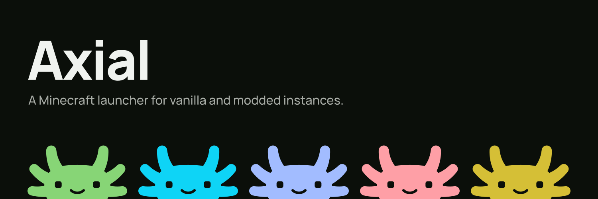

# Axial Web

The landing page for Axial Launcher, built with Astro and pnpm.

## Development

```sh
pnpm install
pnpm dev
```

## Production build

```sh
pnpm build
```

## Cloudflare deployment

Cloudflare Workers Builds runs `pnpm run build`, then `npx wrangler deploy`.
`wrangler.jsonc` explicitly deploys the static files in `dist/`, so Wrangler does
not auto-install an Astro adapter or rebuild the site during deployment.
Wrangler is pinned in the lockfile to keep deployments reproducible.

To build and deploy locally with an authenticated Cloudflare account:

```sh
pnpm run deploy
```

## Branding

The axolotl mark and promotional artwork come from the Axial app's approved
branding (design revision 2). `assets/brand-mark.json` preserves the source geometry
and colours; `public/logo.svg` is the transparent mark, `public/logo.png` is the
app icon, and `public/favicon.svg` and `.png` are the browser icons.

`public/brand/banner.svg` is the original outlined Manrope banner. Both locales
use the original 1280 × 640 `public/brand/social-preview.png` sharing card, whose
English tagline is part of the artwork. Descriptions remain localized.

The product screenshot predates the rebrand. A positioned logo overlay hides its
retired sidebar mark; remove `.screenshot-brand` when replacing the capture with
a new screenshot from the app.
